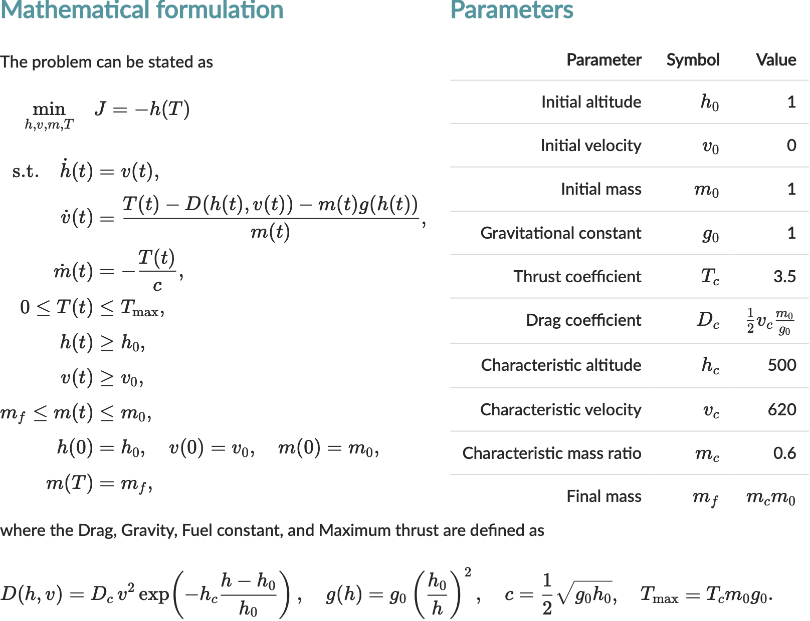

# [With AI](@id modelling-with-ai)

An AI assistant can learn the syntax of OptimalControl.jl from this documentation, then
translate a problem written in mathematics into code that you run. This page gives prompts
to copy into your assistant: open it, paste the first prompt, then the others as you need
them, in the same conversation.

## Teach the assistant

Start with this prompt. It points to three pages: the syntax of [`@def`](@ref modelling-abstract-syntax),
how to [solve](@ref solve-overview) a problem, and how to [read its solution](@ref results-solution).

```text
Learn the syntax of the OptimalControl.jl DSL (Julia language) to translate math into this DSL,
and how to solve a problem and read its solution, from these pages:
https://control-toolbox.org/OptimalControl.jl/dev/modelling/abstract-syntax
https://control-toolbox.org/OptimalControl.jl/dev/solve/overview
https://control-toolbox.org/OptimalControl.jl/dev/results/solution
```

```@raw html
<div style="display:flex; flex-wrap:wrap; align-items:center; gap:8px; margin:16px 0;">
  <span style="font-weight:600;">Open:</span>
  <a href="https://chatgpt.com/?q=Learn+the+syntax+of+the+OptimalControl.jl+DSL+%28Julia+language%29+to+translate+math+into+this+DSL%2C+and+how+to+solve+a+problem+and+read+its+solution%2C+from+these+pages%3A+https%3A%2F%2Fcontrol-toolbox.org%2FOptimalControl.jl%2Fdev%2Fmodelling%2Fabstract-syntax+https%3A%2F%2Fcontrol-toolbox.org%2FOptimalControl.jl%2Fdev%2Fsolve%2Foverview+https%3A%2F%2Fcontrol-toolbox.org%2FOptimalControl.jl%2Fdev%2Fresults%2Fsolution" target="_blank" rel="nofollow noreferrer noopener" style="padding:4px 10px; background-color:#10A37F; color:#fff; border-radius:20px; font-size:13px; font-weight:600; text-decoration:none;">ChatGPT</a>
  <a href="https://claude.ai/new?q=Learn+the+syntax+of+the+OptimalControl.jl+DSL+%28Julia+language%29+to+translate+math+into+this+DSL%2C+and+how+to+solve+a+problem+and+read+its+solution%2C+from+these+pages%3A+https%3A%2F%2Fcontrol-toolbox.org%2FOptimalControl.jl%2Fdev%2Fmodelling%2Fabstract-syntax+https%3A%2F%2Fcontrol-toolbox.org%2FOptimalControl.jl%2Fdev%2Fsolve%2Foverview+https%3A%2F%2Fcontrol-toolbox.org%2FOptimalControl.jl%2Fdev%2Fresults%2Fsolution" target="_blank" rel="nofollow noreferrer noopener" style="padding:4px 10px; background-color:#CC9B7A; color:#fff; border-radius:20px; font-size:13px; font-weight:600; text-decoration:none;">Claude</a>
  <a href="https://copilot.microsoft.com/?q=Learn+the+syntax+of+the+OptimalControl.jl+DSL+%28Julia+language%29+to+translate+math+into+this+DSL%2C+and+how+to+solve+a+problem+and+read+its+solution%2C+from+these+pages%3A+https%3A%2F%2Fcontrol-toolbox.org%2FOptimalControl.jl%2Fdev%2Fmodelling%2Fabstract-syntax+https%3A%2F%2Fcontrol-toolbox.org%2FOptimalControl.jl%2Fdev%2Fsolve%2Foverview+https%3A%2F%2Fcontrol-toolbox.org%2FOptimalControl.jl%2Fdev%2Fresults%2Fsolution" target="_blank" rel="nofollow noreferrer noopener" style="padding:4px 10px; background-color:#0078D4; color:#fff; border-radius:20px; font-size:13px; font-weight:600; text-decoration:none;">Copilot</a>
  <a href="https://gemini.google.com/app" target="_blank" rel="nofollow noreferrer noopener" style="padding:4px 10px; background-color:#4285F4; color:#fff; border-radius:20px; font-size:13px; font-weight:600; text-decoration:none;">Gemini</a>
  <a href="https://chat.mistral.ai/chat?q=Learn+the+syntax+of+the+OptimalControl.jl+DSL+%28Julia+language%29+to+translate+math+into+this+DSL%2C+and+how+to+solve+a+problem+and+read+its+solution%2C+from+these+pages%3A+https%3A%2F%2Fcontrol-toolbox.org%2FOptimalControl.jl%2Fdev%2Fmodelling%2Fabstract-syntax+https%3A%2F%2Fcontrol-toolbox.org%2FOptimalControl.jl%2Fdev%2Fsolve%2Foverview+https%3A%2F%2Fcontrol-toolbox.org%2FOptimalControl.jl%2Fdev%2Fresults%2Fsolution" target="_blank" rel="nofollow noreferrer noopener" style="padding:4px 10px; background-color:#FF7000; color:#fff; border-radius:20px; font-size:13px; font-weight:600; text-decoration:none;">Mistral</a>
  <a href="https://www.perplexity.ai/search/new?q=Learn+the+syntax+of+the+OptimalControl.jl+DSL+%28Julia+language%29+to+translate+math+into+this+DSL%2C+and+how+to+solve+a+problem+and+read+its+solution%2C+from+these+pages%3A+https%3A%2F%2Fcontrol-toolbox.org%2FOptimalControl.jl%2Fdev%2Fmodelling%2Fabstract-syntax+https%3A%2F%2Fcontrol-toolbox.org%2FOptimalControl.jl%2Fdev%2Fsolve%2Foverview+https%3A%2F%2Fcontrol-toolbox.org%2FOptimalControl.jl%2Fdev%2Fresults%2Fsolution" target="_blank" rel="nofollow noreferrer noopener" style="padding:4px 10px; background-color:#9C4DE2; color:#fff; border-radius:20px; font-size:13px; font-weight:600; text-decoration:none;">Perplexity</a>
</div>
```

The buttons open an assistant with this prompt filled in, when the assistant accepts it from
the link; otherwise, or if the message box is empty, paste the prompt above. Some assistants
ask you to sign in first.

The assistant must be able to open web pages. If it cannot, it answers from what it already
knows, which may be an older syntax: check that its answer mentions what is on these pages.

## Translate a problem

Give the problem as you would write it on paper:

```text
Translate the problem below into this DSL:

    minimise the final time tf
    under the constraint q''(t) = u(t)
    with -1 <= u(t) <= 1,
    q(0) = 1, q'(0) = -2, q(tf) = 3, q'(tf) = 1, and q'(t) <= 1.
```

The problem can also be given in LaTeX, or as an image or a PDF attached to the message, if
your assistant accepts files:

```text
Translate the problem in the attached image into this DSL.
```

For instance, with the Goddard rocket problem, also solved in the
[guided tour](@ref getting-started-guided-tour), in this image:

```@raw html

```

## Ask for more

In the same conversation, ask for the rest of the work, for instance:

```text
Solve the problem with a grid of 500 steps, check that the solver succeeded,
and print the final time.
```

```text
Label the constraint q'(t) <= 1, and plot its multiplier.
```

```text
Plot the solution.
```

```text
Give me the values you expect for the final time and the cost,
so that I can compare them with the numerical solution.
```

## Check the answer

!!! warning "Run the code, and check what the assistant says"

    An assistant does not run the code it writes, and its explanations may be wrong even
    when its code is right. In our tries:

    - for the problem above, the code was right, but the assistant announced $t_f = 3$, with
      $u = 1$ on the whole interval: then $q(3) = -1/2$, not $3$. The solution is
      $t_f = 6.5$, with a boundary arc where $q' = 1$;
    - taught with the syntax page only, the assistant forgot to declare the final time,
      `tf ∈ R, variable`, before using it in `t ∈ [0, tf], time`, and the model did not
      build: this is why the first prompt gives three pages;
    - an answer read the solution with `state(sol)[1](t)`, which does not exist: the state
      is a function of time, so write `state(sol)(t)[1]`.

    Run the code, check `successful(sol)`, compare with a value you know, and plot the
    solution (see [Solution object](@ref results-solution)).

These prompts were tried with ChatGPT, without an account, on 15 November 2026.

## See also

- [Abstract syntax (`@def`)](@ref modelling-abstract-syntax) — what the assistant learns.
- [Example gallery](@ref examples-gallery) — worked problems, with their solutions.
- [Guided tour](@ref getting-started-guided-tour) — the Goddard rocket, solved in depth.
